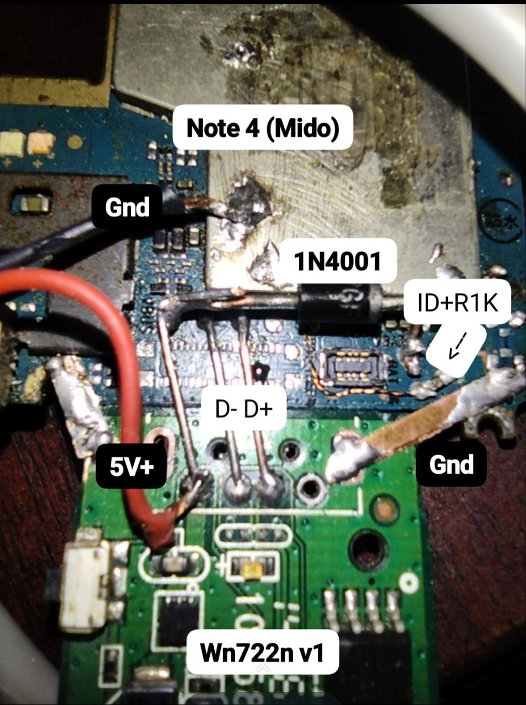

# USB Host Mode + Driver ath9k_htc di postmarketOS (msm8953)

Panduan mengaktifkan **USB host mode** tanpa kabel OTG dan membangun ulang kernel
postmarketOS agar mendukung dongle Wi-Fi **TP-Link TL-WN722N v1** (chipset Atheros AR9271, driver `ath9k_htc`).

Diuji pada:

| Item | Nilai |
|------|-------|
| Perangkat | HP Qualcomm msm8953 (`qcom-msm8953`) |
| OS | postmarketOS / Nura edge (basis Alpine, OpenRC) |
| Kernel | `7.1.3-msm8953` |
| Dongle | TP-Link TL-WN722N v1 (`0cf3:9271`) |
| PC build | Linux x86_64 dengan `pmbootstrap` |

---

## Daftar Isi

1. [Mengaktifkan USB host mode](#1-mengaktifkan-usb-host-mode)
2. [Host mode otomatis saat boot](#2-host-mode-otomatis-saat-boot)
3. [Cek apakah kernel punya driver ath9k_htc](#3-cek-apakah-kernel-punya-driver-ath9k_htc)
4. [Build ulang kernel dengan pmbootstrap](#4-build-ulang-kernel-dengan-pmbootstrap)
5. [Memasang kernel baru ke HP](#5-memasang-kernel-baru-ke-hp)
6. [Memakai dongle](#6-memakai-dongle)
7. [Troubleshooting](#7-troubleshooting)

---

## 1. Mengaktifkan USB host mode

Tanpa kabel OTG, pin ID port USB mengambang, jadi peran USB harus dipaksa lewat sysfs.

Cek apakah role switch tersedia:

```sh
ls /sys/class/usb_role/
```

Contoh hasil: `7000000.usb-role-switch`

Aktifkan mode host:

```sh
cat /sys/class/usb_role/7000000.usb-role-switch/role
echo host | sudo tee /sys/class/usb_role/7000000.usb-role-switch/role
```

Verifikasi dongle terdeteksi:

```sh
lsusb
```

Harus muncul baris seperti `0cf3:9271 ATHEROS USB2.0 WLAN`.

> **Catatan:**
> - Selama mode host aktif, port USB tidak bisa dipakai untuk charging, SSH lewat kabel, atau flashing.
> - Port harus mengeluarkan VBUS 5V. Jika dongle tidak terdeteksi sama sekali, cek `sudo dmesg | grep -i -E "vbus|otg|typec"` atau gunakan hub USB berdaya.
> - Pengaturan ini hilang saat reboot (lihat bagian 2).

---

## 2. Host mode otomatis saat boot

### OpenRC (Alpine / postmarketOS)

```sh
sudo tee /etc/local.d/usbhost.start <<'EOF'
#!/bin/sh
echo host > /sys/class/usb_role/7000000.usb-role-switch/role
modprobe ath9k_htc
EOF
sudo chmod +x /etc/local.d/usbhost.start
sudo rc-update add local default
echo ath9k_htc | sudo tee -a /etc/modules
```

Jika role kembali ke `device` setelah boot, tambahkan `sleep 5` sebelum perintah `echo`.

### systemd (jika dipakai)

```sh
sudo tee /etc/systemd/system/usbhost.service <<'EOF'
[Unit]
Description=USB host mode
After=sysinit.target

[Service]
Type=oneshot
ExecStart=/bin/sh -c 'echo host > /sys/class/usb_role/7000000.usb-role-switch/role'
RemainAfterExit=yes

[Install]
WantedBy=multi-user.target
EOF
sudo systemctl enable usbhost
```

---

## 3. Cek apakah kernel punya driver ath9k_htc

Di HP:

```sh
sudo modprobe ath9k_htc
zcat /proc/config.gz | grep -E "ATH9K|MAC80211|CFG80211"
```

Jika muncul `Module ath9k_htc not found` dan `# CONFIG_ATH9K_HTC is not set`,
kernel perlu dibangun ulang (bagian 4). `CFG80211` dan `MAC80211` biasanya sudah `=m`.

---

## 4. Build ulang kernel dengan pmbootstrap

Dikerjakan di **PC Linux** (cross-compile ke aarch64). Siapkan ruang disk sekitar 10 GB.

### 4.1 Siapkan pmbootstrap

```sh
git clone https://gitlab.postmarketos.org/postmarketOS/pmbootstrap.git
cd pmbootstrap
python3 pmbootstrap.py init
```

Pilih vendor `qcom` dan device `msm8953`, dengan kernel yang sama seperti di HP.
Cek nama paket kernel di HP dengan `apk info | grep linux`.

### 4.2 Aktifkan opsi kernel

```sh
pmbootstrap kconfig edit linux-postmarketos-qcom-msm8953
```

Di menuconfig buka:

`Device Drivers → Network device support → Wireless LAN`

- `[*] Atheros/Qualcomm devices` (`WLAN_VENDOR_ATH`)
- `<M> Atheros HTC based wireless cards support` (`ATH9K_HTC`)

`ATH9K_HW`, `ATH9K_COMMON`, dan `ATH_COMMON` ikut terpilih otomatis.
Opsi `Atheros 802.11n wireless cards support` (`ATH9K`, versi PCI) tidak perlu dinyalakan.

Simpan saat keluar (Esc dua kali, pilih **Yes**).

### 4.3 Naikkan pkgrel dan buat checksum

Tanpa langkah ini `pmbootstrap` bisa menganggap paket "up to date" dan melewati kompilasi.

```sh
cd "$(pmbootstrap config aports)"
grep -rl "linux-postmarketos-qcom-msm8953" --include=APKBUILD .
# buka APKBUILD hasil grep, naikkan angka pkgrel= (mis. 1 -> 2)
pmbootstrap checksum linux-postmarketos-qcom-msm8953
```

### 4.4 Build

```sh
pmbootstrap config jobs $(nproc)
pmbootstrap build linux-postmarketos-qcom-msm8953 --force
```

Kompilasi memakai CPU saja (GPU tidak bisa dipakai oleh compiler).
Pada laptop 2 core / 4 thread, prosesnya sekitar 2 jam.

### 4.5 Cek hasil build

```sh
sudo find "$(pmbootstrap config work)" -name "linux-postmarketos-qcom-msm8953-*.apk"
```

Pakai file di `packages/edge/aarch64/` (bukan yang di `cache_apk_aarch64/`). Salin dan cek isinya:

```sh
sudo cp <path_apk_hasil_find> ~/
sudo chown $USER:$USER ~/linux-postmarketos-qcom-msm8953-*.apk
tar tzf ~/linux-postmarketos-qcom-msm8953-*.apk | grep ath9k
```

Harus muncul `ath9k_common.ko`, `ath9k_htc.ko`, dan `ath9k_hw.ko`.
Peringatan `Ignoring unknown extended header keyword 'APK-TOOLS.checksum.SHA1'` dari tar tidak berbahaya.

---

## 5. Memasang kernel baru ke HP

Kirim paket dari PC ke HP:

```sh
scp ~/linux-postmarketos-qcom-msm8953-*.apk <user_hp>@<ip_hp>:~/
```

Alternatif tanpa SSH:

```sh
# di PC
cd ~ && python3 -m http.server 8000
# di HP
wget http://<ip_pc>:8000/linux-postmarketos-qcom-msm8953-<versi>.apk
```

Pasang di HP:

```sh
sudo apk add --allow-untrusted --force-reinstall ~/linux-postmarketos-qcom-msm8953-*.apk
sudo depmod -a 7.1.3-msm8953
sudo apk add linux-firmware-ath9k_htc
```

Jika modul tidak cocok dengan kernel yang sedang berjalan (`Exec format error` atau
`disagrees about version of symbol`), flash boot image baru dari PC dengan HP dalam mode fastboot:

```sh
pmbootstrap flasher flash_kernel
```

**Cadangkan boot image lama terlebih dahulu**, mis. dari HP:

```sh
sudo dd if=/dev/disk/by-partlabel/boot of=boot-backup.img
```

---

## 6. Memakai dongle

```sh
echo host | sudo tee /sys/class/usb_role/7000000.usb-role-switch/role
sudo modprobe ath9k_htc
sudo dmesg | tail -20
ip link
iw dev
sudo iw dev wlan1 scan | grep SSID
```

Nama interface bisa berbeda (`wlan1`, `wlan2`, dan seterusnya).

---

## 7. Troubleshooting

| Gejala | Penyebab / solusi |
|--------|-------------------|
| `usb_role` tidak ada | Cek `sudo ls /sys/kernel/debug/usb/`. Jika tidak ada jalur role, ubah `dr_mode = "host"` di device tree dan build ulang kernel |
| `lsusb` tidak menampilkan dongle | VBUS tidak keluar. Coba hub USB berdaya |
| `dmesg: Operation not permitted` | Pakai `sudo dmesg` |
| `Module ath9k_htc not found` | Kernel belum dibangun dengan `CONFIG_ATH9K_HTC=m` (bagian 4) |
| `pmbootstrap build` bilang "up to date" | Naikkan `pkgrel`, jalankan `checksum`, lalu `build --force` |
| `firmware htc_9271.fw not found` | `sudo apk add linux-firmware-ath9k_htc` |
| `ls /sys/kernel/debug/usb/` permission denied | Pakai `sudo` |
| Perintah yang ditempel menyatu jadi satu baris | Jalankan satu per satu |


## Dokumentasi Hardware



## 7. Mematikan hemat daya Wi-Fi

Kernel dengan CONFIG_CFG80211_DEFAULT_PS=y menyalakan power save Wi-Fi secara default.
Akibatnya koneksi (misalnya SSH) bisa terasa lambat atau putus-putus.

Cek nama interface dan status power save:

```sh
iw dev
iw dev wlan0 get power_save
```
Contoh: wlan0 adalah Wi-Fi internal (phy#0) dan wlan1 adalah dongle TL-WN722N (phy#1).

Matikan (langsung berlaku, hilang saat reboot):

```sh
sudo iw dev wlan0 set power_save off
iw dev wlan0 get power_save
```
Hasil yang diharapkan: Power save: off.

### Permanen (OpenRC)

```sh
sudo tee /etc/local.d/wifi-ps.start <<'EOF'
#!/bin/sh
sleep 10
iw dev wlan0 set power_save off
iw dev wlan1 set power_save off
EOF
sudo chmod +x /etc/local.d/wifi-ps.start
sudo rc-update add local default
```
*sleep 10* memberi waktu agar interface sudah muncul. Sesuaikan nama wlan0/wlan1 dengan
hasil *iw dev*. Skrip ini bisa berjalan bersamaan dengan *usbhost.start* dari bagian 2.

### Permanen (NetworkManager)

NetworkManager dapat menimpa setelan manual saat reconnect, jadi atur lewat konfigurasinya:

```sh
sudo tee /etc/NetworkManager/conf.d/wifi-powersave.conf <<'EOF'
[connection]
wifi.powersave = 2
EOF
sudo rc-service networkmanager restart
```

Jika koneksi masih lambat, cek kualitas sinyal dengan `iw dev wlan0 link`.

